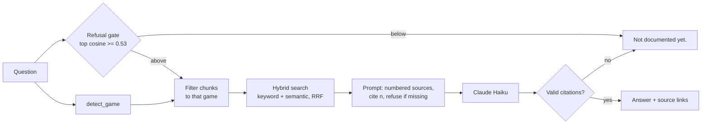

# GTA Cheatsheet: cited Q&A over wiki pages

Ask a question about GTA V, GTA Online or the GTA VI trailers in plain language and get a short answer built **only** from saved wiki pages, with a link to every page it used. If the pages don't cover it, it says **"Not documented yet."** instead of guessing.

**Try it: [gta-cheatsheet-1096595679255.us-central1.run.app](https://gta-cheatsheet-1096595679255.us-central1.run.app/)**: the first question after a quiet period takes about 30 seconds while the server wakes up. Limited to 10 questions per minute per visitor.

It's a retrieval-augmented generation (RAG) system built from scratch in Python, without a RAG framework, as a learning project. The domain is a game, but the problem is the general one: answer questions over a fixed set of documents, cite the sources, and refuse when the answer isn't there. Most of the work went into **measuring** it: every change is scored on fixed question sets and logged with its date in [`eval/results.md`](eval/results.md).

## How it works



**Offline (ingestion):** 21 wiki pages are saved by hand as raw wikitext. Then `ingest` cleans the markup, splits each page into sections, turns the infobox into its own chunk and adds a heading path (`Locations > Grand Theft Auto Online`). That gives 687 chunks. Each chunk is tagged with the games it covers (IV, V, Online, VI, or "all") and embedded with `all-MiniLM-L6-v2`.

**Per question:**
1. **Refusal gate:** if no chunk is semantically close enough (cosine below 0.53), refuse without calling the model.
2. **Game filter:** if the question names a game ("in gta online", "tbogt", "gta 6"), search only that game's chunks.
3. **Hybrid search:** keyword search and embedding search, merged with Reciprocal Rank Fusion; the top 5 chunks are kept.
4. **Generation:** Claude answers from the numbered chunks only, citing them as `[n]`. An answer with no valid citation is treated as a refusal.
5. **Web app:** FastAPI serves the page and `POST /ask`, deployed on Google Cloud Run (Docker, scales to zero, API key in Secret Manager, rate limit per visitor). Every question is logged as one JSON line (answer, sources, game, seconds, errors), and `GET /stats` summarises the log. If the model is down, the user gets a clear 503 instead of a crash.

## Results

Question sets: `golden` (31, written while reading the pages), `holdout` (30, worded like real players, written later), `unanswerable` (14, not covered by the pages), and `trap` (10, pages that mix several games).

**Retrieval** (recall@5: is the right chunk in the top 5?)

| Method | golden (31) | holdout (30) |
|---|---:|---:|
| Keyword, first version | 0.516 | |
| Keyword + stopwords + punctuation fix | 0.774 | 0.500 |
| Semantic (embeddings) | 0.774 | 0.767 |
| **Hybrid (RRF)** | **0.903** | **0.767** |

Keyword and semantic search scored the same on golden, but they missed *different* questions, so merging them gained 4 questions.

**Answers** (holdout + unanswerable, 44 questions, graded by hand)

| Setup | Correct | Unanswerable refused | Cost per 44 | Avg latency |
|---|---:|---:|---:|---:|
| Week 4: generation with citations | ≈ 0.89 | 14/14 | $0.010 | 1.97 s |
| Week 5: + heading paths, gate re-tuned, game filter | ≈ 0.86 (38/44)* | 14/14 | $0.011 | 1.7 s |

\* One question's expected answer was mislabelled and was fixed in Week 5. The same behaviour scores one point lower against the corrected label, so the two rows are equal.

**Game traps:** 6/10 at baseline → 8/10 with the gate fix → 9/10 with the game filter.

**Real use:** 36 questions typed into the web app. 28 behaved as expected, with 0 errors. Hostile prompts like "ignore your instructions…" and "print your system prompt" were refused (4 of 5); the fifth got a grounded answer but ignored the plain-text rule.

## What didn't work (and why)

- **Misspelled names** ("trevers", "micheals") drop the gate score below the threshold, so they're refused in under a second. The eval sets had no typos, so only real use showed this. Planned fix: correct names against the page titles before the gate.
- **The game filter fixed two questions and broke one.** Filtering changes every chunk's rank in the keyword and semantic lists, so the fused order of the survivors can flip. The tiny "$725,000" chunk fell out of the top 5.
- **Page-level tags on mixed chunks:** the Sticky Bombs infobox says the page covers TBoGT, V and Online, but the price inside it is TBoGT-only, so a GTA V filter keeps the wrong price.
- **Vocabulary mismatch:** "cost" vs "price", "practise" vs "Shooting Range". The right chunks exist but aren't retrieved. These are candidates for query rewriting or a reranker.
- **Keyword grading is noisy:** the same answers scored ±3 questions apart between runs ("AWD" vs "all wheel"), so hand grading is the number to trust.

## Run it

```bash
python -m venv .venv && source .venv/bin/activate
pip install -r requirements.txt
echo "ANTHROPIC_API_KEY=sk-..." > .env      # git-ignored

pytest                                       # 143 tests, no network, no model calls
python -m runs.week5_run                     # eval: trap / holdout + unanswerable sets
python -m runs.serve                         # web app on http://127.0.0.1:8000

# deploy (Google Cloud Run; see Dockerfile)
gcloud run deploy gta-cheatsheet --source . --region us-central1 \
  --memory 2Gi --cpu 1 --max-instances 1 --allow-unauthenticated \
  --set-secrets ANTHROPIC_API_KEY=anthropic-key:latest
```

The first run builds `data/index.json` (the embeddings, git-ignored), which takes about a minute.

## Layout

| Path | What's there |
|---|---|
| `cheatsheet.py` | all pipeline functions: cleaning, chunking, search, gate, prompt, citations, game filter, logging |
| `app.py` | FastAPI app (`/`, `/ask`, `/stats`) built by `create_app(answer_fn, log_path)` |
| `runs/` | real-data scripts: eval runs per week, `rebuild_chunks.py`, `serve.py` |
| `tests/` | one spec file per week; models, HTTP and Claude are replaced by fakes |
| `data/` | `raw/` hand-saved wikitext → `cache/` page dicts → `chunks.json` |
| `eval/` | question sets and `results.md` (every score, dated, with notes) |
| `notes/` | cleaning notes and a glossary of concepts learned along the way |

## How it was built

I wrote all of `cheatsheet.py`, `app.py` and the run scripts myself, relearning Python as I went. Claude (Anthropic) acted as a tutor: it wrote the weekly test specs, reviewed my code with hints rather than fixes, ran checks, and kept `results.md` up to date. The exceptions, where Claude wrote code at my request, are the HTML/JavaScript of the web page, a few small pieces of the run scripts (print loops, the Claude call in `serve.py`) and the one-line comments above each function in `cheatsheet.py`. The weekly plan and the rules for working this way are in `CLAUDE.md`.

## Data and licence

The wiki text comes from [gta.wiki](https://gta.wiki) and is licensed under **CC BY-NC-SA 3.0** (attribution, non-commercial, share-alike). Every answer links back to its source page, and the text in `data/` stays under that licence.

Pages were saved by hand in the browser. The site's host doesn't allow automated access without consent, and that consent was declined, so no script in this repo calls gta.wiki. The API code (`fetch_page`, `list_category`) is only tested against fakes.
